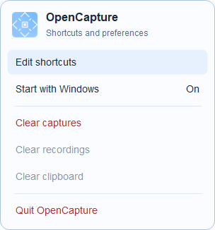

# OpenCapture

OpenCapture is a lightweight Windows screenshot tool that lives in the notification area.

GitHub repository: [ericxyuan/opencapture](https://github.com/ericxyuan/opencapture). Maintainer: [ericxyuan](https://github.com/ericxyuan).

Version 1.19.0 refines the tray menu and reduces work in the floating capture and review panels. The app remains a standalone executable with no added runtime dependencies.



## Use

1. Run `OpenCapture.exe` once. It registers itself to start when you sign in and remains in the notification area.
2. The startup window shows aligned controls for capture, HEX copy, zone selection, recording mode, and recording start/stop. Click a shortcut field and press a replacement key combination; the capture-zone action can also use a mouse button. While this keybind window is open, every OpenCapture shortcut is suspended, so selecting or typing a currently assigned binding cannot activate its action. The final saved bindings are registered only after the window closes. The recording dropdown limits its mode shortcut to after the capture interface opens or makes a distinct shortcut always available. **Reset Keybinds** restores Alt+Q, Ctrl+C, Tap, Alt+Q, Space, and the default recording availability together. Hold the X until its ring completes to stop showing this window automatically. The same controls remain available from **Edit shortcuts** in the tray.
3. Press **Alt+Q** by default. There is no countdown or intentional wait: the desktop is copied before the selection overlay appears.
4. Hover to inspect a detected window, native control, application control, Windows shell element, or visually distinct colour block. Browser and Chromium-style app buttons, tabs, cards, images, and bounded panels are discovered asynchronously beneath the frozen screen, so useful inner zones remain available even when the app uses only one native window. Whole-monitor zones and zones filling the Windows work area—full screen except for the taskbar—are ignored rather than highlighted. This comparison allows for the invisible DWM resize frame that Windows adds just beyond a maximized window's visible edges. Transparent click-through overlay windows, such as crosshair and performance-overlay surfaces, are also skipped so their invisible host bounds cannot become zones. The light-blue target can be captured with a quick click.
5. To make a free selection, hold the left button for more than 300 ms and then drag. Movement during a quick click still captures the original hovered zone. Press **Esc** or right-click to cancel.
6. The selected pixels flash once, then a compact review appears with **Confirm**, **Crop**, and **Discard**. Its blue donut drains evenly over two seconds. Confirm, expiry, or clicking outside accepts the result; Discard cancels it without changing the clipboard or saving a screenshot. Accepted pixels are saved as a PNG in `Captures` beside the executable and placed on the clipboard in one transaction. Names use `HH-MM-SS --- DD-MM-YY.png`, adding milliseconds only for a same-second collision.

The same two-second review follows screenshots, HEX colours, copied text, and completed recordings, using the same translucent-white surface, light-blue outline, shadow, corner radius and Proxima Nova fonts as the precision panel. It contains no automatic-save/copy instruction text. Colour review offers Confirm and Discard; images, text source images, and recordings also offer Crop. Crop shows only draggable resize tabs on the captured pixels in their original screen position, without an editor window or toolbar. The review remains visible indefinitely in crop mode and its Crop action becomes Done. Done removes the handles and restarts the full two-second countdown; Enter also finishes cropping and Escape restores the pre-crop bounds. Cropped text is recognised again before copying, and cropped recordings retain their original frame count and 60 FPS timing. Recordings awaiting review are private temporary files in `Videos\.Pending`; accepting moves or exports the recording into `Videos`, while discarding removes only that private recording. Large video crops are streamed off the interface thread, one frame at a time. The clipboard is updated only on acceptance, so colour codes become available on Confirm, click-away, or the two-second expiry; Discard leaves the prior clipboard untouched.

The cursor-adjacent information panel follows mouse movement with a subtle, bounded 45 ms trailing response rather than snapping. It is a small independently composited alpha surface, so moving it does not copy/repaint the desktop behind it. A high-resolution 8 ms presentation deadline coalesces mouse reports into one latest frame, never a backlog of older positions; the inactive clock sleeps rather than continuously polling. Dirty overlay painting uses the actual separated update regions and bounded 640-pixel tiles instead of repainting their enclosing rectangle. The precision cursor, selection bounds, pixel colour, and keyboard nudges remain immediate. Motion stops when the panel settles and is disabled when Windows requests reduced animation. Existing selection-avoidance positioning is preserved.

By default, while the overlay is open, press **Alt+Q** again to switch to recording mode. The target highlight changes from blue to red. A quick click on a detected zone flashes it and starts recording that zone immediately. For a custom area, hold the left button for more than 300 ms and drag; the chosen area remains visible, and the configured recording control (Space by default) starts recording it. While recording, the capture-excluded storage panel displays that same control and **Stop**. Press it again to stop. Pressing the recording-mode shortcut again before recording starts returns to screenshot mode. If recording mode is set to **Always Available**, its distinct global shortcut opens directly in recording selection mode.

Recordings run at 60 FPS and are saved as dependency-free MJPEG AVI files in `Videos` beside the executable. On active HDR displays, recording keeps a persistent native FP16 Desktop Duplication session and applies the same per-display scRGB-to-SDR reference-white reversal as screenshots; the last converted compositor frame is reused between presents so GDI's washed-out HDR representation never flashes into the video. Recordings use the same `HH-MM-SS --- DD-MM-YY.avi` timestamp naming convention, with milliseconds only for a same-second collision. When recording finishes, the video is also copied to the Windows clipboard as a file so it can be pasted into compatible apps. A thin red border remains around the recorded area until recording stops.

Press **Ctrl+C** by default while the overlay is passively inspecting the screen—including while a detected zone is highlighted—to copy only the current `#RRGGBB` colour code and close the overlay. If an active hold-and-drag area is being moved, Ctrl+C instead uses Windows' local OCR, copies the recognised text as text only, and saves the selected pixels in `Copied Text` beside the executable. OCR automatically upscales small text and compares colour, contrast-enhanced, black-on-white, and white-on-black passes across every Windows OCR language pack installed on the PC. The image filename is the recognised text, with unsafe filename characters removed and a number added only for a collision. The cropped image is never placed on the clipboard. Both paths flash once before the overlay closes.

While a manual area is still being shaped, OCR runs continuously outside the interface thread. The first scan begins directly from mouse movement rather than waiting for the area to settle; changes made during a scan are coalesced into the next immediate pass. Recognised words receive a light-blue, softly flowing highlight driven by their actual OCR bounds, and the animation starts as soon as the first text result arrives. The moving sweep temporarily increases the contrast of the original pixels beneath it so both dark and light lettering remain legible through the stronger blue tint. There is no separate text-preview card. Releasing the mouse for a normal screenshot or recording removes the OCR layer before capture, so it cannot appear in the saved media. If the active area is copied as text, an exact live result is reused when possible. Traditional Chinese OCR output is converted locally to Simplified Chinese before copying or naming its source image.

The precision panel shows an 11×11 nearest-neighbour pixel view, the selected pixel's sRGB HEX value and swatch, physical desktop coordinates, current selection dimensions, mouse sensitivity, and estimated output storage. It normally treats an active manual selection or hovered zone as an exclusion area. For a large hovered zone, once the pointer is at least 48 pixels inside every edge and the panel covers no more than 12% of the zone, the panel stays in its simple normal cursor-adjacent position. Near an edge, over a compact zone, or during a manual selection, it moves just outside the nearest available target edge. Whole-monitor and taskbar-excluded full-screen hover zones are suppressed, leaving no exclusion area and returning the panel beside the cursor. If a full-display manual drag makes overlap unavoidable, the least-obstructive on-screen position is used. Its border uses a fixed 12-pixel content inset, and the centre hairlines use slightly stronger partial coverage while remaining visually lighter than a full opaque pixel. Use the arrow keys or WASD for exact one-pixel cursor nudges without the mouse. Scroll to change physical mouse sensitivity from 25–400%; at 50%, twice the physical mouse travel is required for the same on-screen distance. Press the scroll wheel to return immediately to 100%. Every new overlay also starts at 100% rather than remembering the previous session. Screenshot mode displays an approximate PNG size. Recording mode displays the approximate 60 FPS MJPEG storage per minute and begins at `0 KB used`; while recording, a small capture-excluded status panel updates the current logical AVI size. The centred `≈` symbol indicates that compression varies with the captured content.

Right-click the tray icon for the compact OpenCapture menu. Settings, cleanup actions and Quit are grouped separately; **Start with Windows** displays its current On/Off state. Use Up/Down or Tab to move between enabled actions, Home/End to reach the first/last action, Enter/Space to activate and Escape to dismiss. The menu scales to the monitor's DPI and uses Windows system colours in high contrast mode. It can reopen **Edit shortcuts**, clear managed screenshots and recordings separately, clear the clipboard only when it still contains an OpenCapture-marked screenshot or recording, or explicitly quit. Folder checks run in the background after the menu opens; their actions stay disabled while checking. Clear captures and Clear recordings are independently greyed out when no managed files remain. Cleanup still rechecks ownership before deleting anything. If a capture or recording is renamed, replaced, or edited, it is permanently retired from automatic cleanup—even if its original name is restored later. Copied text, colour codes, third-party images, unrelated files, and subfolders are not cleared.

Floating panels reuse a native top-down bitmap and drawing context until their size changes. The precision preview also reuses its managed bitmap, and the review caches its thumbnail, text, chrome and buttons while animating the countdown ring. Closing the panels releases their buffers. Very small countdown arcs are omitted below half a degree, and the complete ring is drawn as an ellipse to avoid degenerate GDI+ arcs.

Live OCR checks whether its overlay request is still current before preparing an image and between recognition passes. Closing or resetting the overlay lets obsolete work stop after the current Windows recognition call finishes. Active requests retain every installed language and contrast pass.

While idle, shell-zone prewarming is driven by foreground, taskbar, and tray change notifications instead of continuous UI Automation scans. Bursts of shell events are combined, and a slow safety refresh remains active, so zone behavior is preserved without repeatedly waking the CPU while OpenCapture sits in the tray. Shell scans are paused during capture and recording. Tray artwork and menus are also created at their displayed size and only when needed.

If Windows or a third-party accessibility provider causes a terminating background failure, the same standalone executable restarts itself after the failed process has exited and reports the recovery through the notification area. Recovery is bounded to three rapid attempts and resets after one stable minute, so a persistent startup fault cannot create an endless restart loop. Choosing **Quit** always suppresses recovery. Fatal details are written beside the executable when possible, with `%LocalAppData%\OpenCapture\OpenCapture.log` as a fallback when the application folder is temporarily unavailable.

The selection overlay uses small clipped buffers for only the cursor, precision panel, and regions whose highlight changed. Zone analysis is coalesced to the newest pointer position and runs outside the interface thread, avoiding both full-desktop repaints and cursor stalls on large desktops. Application accessibility discovery is lazy, cached per underlying window, and hard-limited to 1.2 seconds; a slow or broken app falls back to native geometry and frozen-pixel analysis without delaying or repeatedly refreshing the interface.

Ownership-index housekeeping is best effort: if a sync client or scanner locks a temporary ownership file, OpenCapture logs the cleanup failure and continues. Leftover temporary files are ignored; failures to save the actual ownership index are still reported.

Cleanup rechecks each screenshot or recording immediately before moving it to the Recycle Bin, so edits made while a batch is clearing retire that file from automatic cleanup. Malformed numeric ownership rows are ignored alongside other invalid rows. OCR image names also protect Windows device names even when the recognised text includes a file extension.

Repeated visual-zone queries at the same physical pointer position and enclosing bounds reuse their result, including an unchanged background with no inner zone. On HDR recordings, pointer-only Desktop Duplication updates reuse the converted compositor image. Recording startup preserves any file that already occupies its selected name and reports a failed desktop copy instead of saving a stale frame.

## Build

In PowerShell, Windows Terminal, or the VS Code terminal, from the OpenCapture workspace (`C:\Users\admin\iCloudDrive\OpenCapture`) on 64-bit Windows with .NET Framework 4.8, run:

```powershell
.\build.ps1
```

This creates the standalone `OpenCapture.exe` in this folder. No installer or additional package is required on a standard Windows 10/11 PC with .NET Framework 4.8.

Use `-OutputPath <path>` to build a separate executable while the current app is running. Run the source regression suite with:

```powershell
.\test.ps1
.\test.ps1 -ReviewOnly
.\test.ps1 -OwnershipOnly
```

The full suite includes live desktop, HDR, OCR and shell discovery checks and briefly displays test windows. The focused review suite covers the new storage, recording safety, visual-cache and tooltip regressions. Test executables are built outside the workspace by default; `-OutputDirectory <directory>` saves them at a chosen location. A successful run must print both `PASS` and `EXIT=0`; a nonzero process exit causes the script to fail even if assertions already passed.

## Capture details

- OpenCapture is Per-Monitor-V2 DPI aware and uses physical virtual-desktop pixels, including negative coordinates on left/top monitors.
- HDR is detected independently for every active display. Ordinary app colours are kept byte-for-byte because Windows already captures those correctly. HDR outputs are acquired in their native FP16 scRGB format through Desktop Duplication and converted to SDR using that display's current Windows reference-white level. This prevents the adjustment from darkening normal apps while still tone-mapping HDR-native content for the overlay, HEX sample, clipboard image, and saved PNG. SDR displays in a mixed setup are left unchanged.
- The saved crop always comes from the frozen backing frame, never from the overlay, so the crosshair, magnifier, and blue highlight cannot appear in the result.
- Zone discovery combines front-to-back window/control geometry, cached application and Windows-shell UI Automation data, and frozen-pixel colour segmentation. Browser and Chromium-style app controls can therefore remain distinct even when the app exposes no child HWNDs. Taskbar apps, Start/search/task-view/widgets, tray icons, overflow, clock/calendar, quick settings/action centre, notification centre, and shell flyouts are measured from their current live bounds and treated as separate semantic zones.
- Colour segmentation identifies filled cards, panels, and blocks in custom-drawn applications, while treating text and icons as holes inside their enclosing colour region rather than tiny standalone targets. Rounded cards and pill-shaped controls use their complete rectangular outer bounds, including the otherwise unused corner pixels. A rounded panel that touches a matching-colour sidebar is separated from that adjoining surface instead of being merged into it. A separate four-edge enclosure pass detects faint custom-drawn side panels whose fill is too close to the surrounding surface for colour flooding, while full-edge validation prevents text strokes from becoming panel zones.
- Gentle gradients are treated as one surface instead of being split at tiny colour steps.
- Proxima Nova A, the supplied startup artwork, and the supplied tray icon are embedded in the executable. The font file comes from the repository specified for this build; make sure any redistribution complies with the font owner's licence.
- Ordinary applications cannot capture the secure sign-in/UAC desktop, and Windows can mask protected video.
